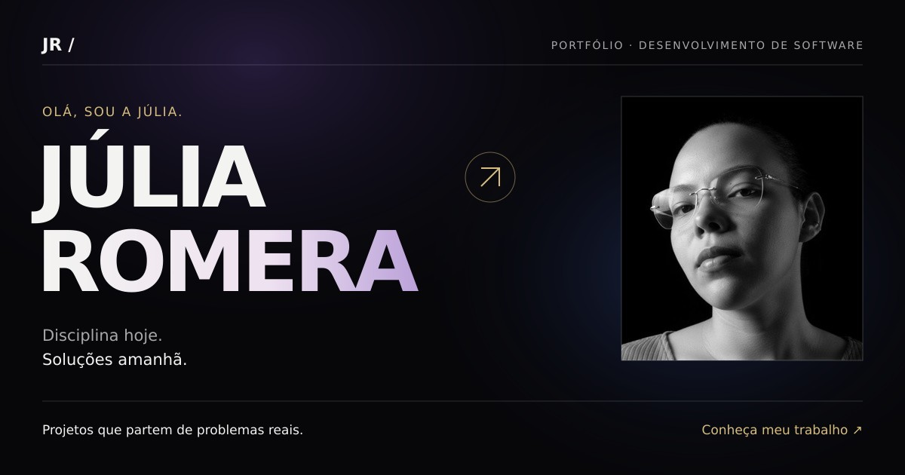

# Portfólio — Júlia Romeira

Portfólio pessoal em desenvolvimento, criado para apresentar minha trajetória do
suporte técnico ao desenvolvimento de software e destacar projetos construídos
para resolver problemas reais.

**Acesse online:** [portfolio-julia-nine.vercel.app](https://portfolio-julia-nine.vercel.app)

O portfólio reúne projetos práticos e experiências relacionadas a desenvolvimento de software. O README documenta a apresentação pública e o repositório preserva o código e as verificações automatizáveis.

## Projeto em destaque

- **Mira Distribuidora:** plataforma de catálogo e cotações para um negócio real.
- **Leve MP4:** compactador de vídeos que processa os arquivos diretamente no navegador.
- **[Base de Conhecimento](https://base-de-conhecimento-facil.netlify.app/):** portal de documentação para clientes, com busca e conteúdo em Markdown.

## Tecnologias desta primeira versão

- HTML
- CSS
- JavaScript

## Como executar localmente

Como é um site estático, basta abrir `index.html` em um navegador ou iniciar um
servidor local na raiz do projeto. Não há dependências para instalar nem etapa de build.

## Publicação

O site é publicado na Vercel. Cada push na branch `main` gera automaticamente
um novo deploy de produção.

## Objetivo

Construir o portfólio de forma incremental, com uma estética dark premium,
hierarquia visual forte e animações sutis guiadas pela rolagem da página.

---

Desenvolvido por [Júlia Romeira](https://github.com/JuliaRomeira).

## Verificações

A pasta `tests/` contém verificações de navegação, páginas, animações e responsividade. Alguns testes de interface utilizam Playwright e dependem de navegador e servidor local configurados. A existência dos testes não significa, por si só, que todos estejam passando em CI.
